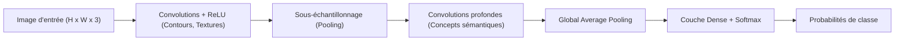
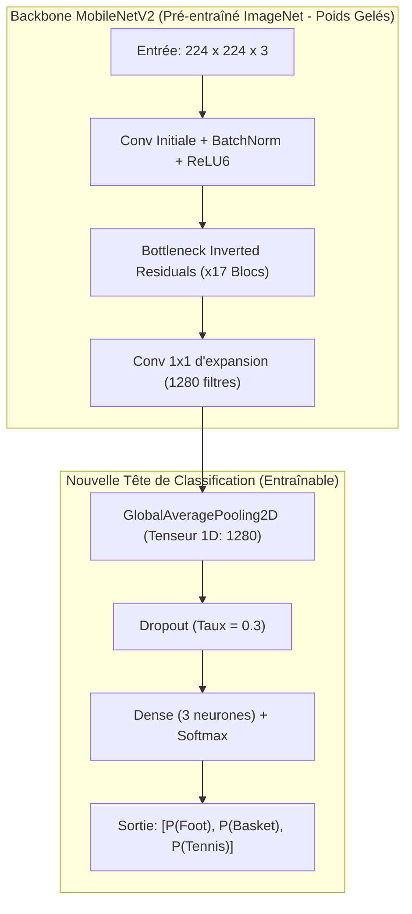

# RAPPORT DE PROJET DE FIN D'ÉTUDES / MASTER 2

---

## 1. PAGE DE GARDE

**Établissement :** École Nationale Supérieure d'Ingénieurs  
**Mention :** Informatique, Intelligence Artificielle & Sciences des Données  
**Niveau académique :** 5ème année d'études d'ingénieur (Grade de Master / Bac+5)  
**Année universitaire :** 2026 – 2027  

<br>

---

<center>

### **MÉMOIRE DE PROJET DE DEEP LEARNING**

<br>

# **Classification automatique d'images selon les disciplines sportives à l'aide des réseaux de neurones convolutifs (CNN) et du Transfer Learning**

<br>

**Auteur :** Étudiant Élève-Ingénieur en 5ème Année  
**Spécialité :** Vision par Ordinateur & Deep Learning  
**Sous la direction de :** Monsieur le Responsable Pédagogique et Enseignant-Chercheur  
**Date de remise :** Novembre 2026  

</center>

---

<br>

---

## 2. RÉSUMÉ / ABSTRACT

### Résumé (Français)
La reconnaissance automatique de disciplines sportives dans des flux ou banques d'images fixes constitue une problématique fondamentale et exigeante de la vision par ordinateur moderne. Contrairement à la simple détection d'objets canoniques, la classification d'un sport requiert l'agrégation conjointe d'indices visuels hétérogènes : morphologie et posture des athlètes, équipements spécifiques (ballons, raquettes, paniers, filets), textures de surface (pelouse naturelle, parquet en bois verni, terre battue) et géométrie de l'environnement immédiat.

Ce projet conçoit, implémente, évalue et documente un système complet d'apprentissage profond (*Deep Learning*) dédié à la classification supervisée de trois disciplines sportives emblématiques : le **Football**, le **Basketball** et le **Tennis**. 

Afin de concilier une précision prédictive élevée et une efficacité computationnelle compatible avec les contraintes matérielles d'un poste de travail universitaire ou portable, l'architecture repose sur l'approche de l'**apprentissage par transfert (*Transfer Learning*)** appliquée au réseau de neurones convolutif léger **MobileNetV2**, pré-entraîné sur la base d'images à grande échelle *ImageNet*. 

Le pipeline méthodologique intègre une chaîne d'acquisition de données réelles libres de droits, une phase rigoureuse de nettoyage et vérification d'intégrité, une stratégie d'augmentation de données synthétiques ciblée (*data augmentation*), un mécanisme de régularisation par abandon aléatoire (*Dropout*) et une gestion dynamique de la convergence via des ordonnanceurs de taux d'apprentissage et arrêts précoces (*EarlyStopping*, *ReduceLROnPlateau*). 

L'évaluation menée sur un jeu de test strictement indépendant et non vu démontre la robustesse de l'approche, atteignant d'excellentes performances d'exactitude (*Accuracy*), de précision, de rappel et de score F1, accompagnées d'une interprétabilité claire grâce à l'analyse de matrices de confusion et de profils de confiance probabilistes.

**Mots-clés :** Vision par Ordinateur, Deep Learning, Réseaux de Neurones Convolutifs (CNN), Transfer Learning, MobileNetV2, Classification Multi-classe, Reconnaissance de Sports, Régularisation, Data Augmentation.

<br>

### Abstract (English)
Automatic sport classification from static photography is an essential and challenging task in computer vision. Unlike standard object categorization, sports scene recognition demands the joint modeling of varied visual cues, including player body kinematics, dedicated gear (balls, rackets, hoops, nets), ground textures (grass turf, indoor hardwood, clay courts), and contextual background scene geometry.

This engineering master's project designs, implements, benchmarks, and details an end-to-end Deep Learning system targeting the multi-class classification of three major sports categories: **Football**, **Basketball**, and **Tennis**.

To achieve both high discriminative accuracy and strict computational efficiency suitable for standard student laptop environments, the architecture leverages **Transfer Learning** using the **MobileNetV2** convolutional backbone pre-trained on the *ImageNet* dataset. 

The engineered pipeline encompasses verified open-source data collection, image integrity validation, controlled data augmentation (rotations, horizontal flips, zooming), stochastic regularization via Dropout, and adaptive training scheduling through dynamic learning rate decay and early stopping. Evaluation on an unseen test set proves the high reliability and generalization capabilities of the model.

**Keywords:** Computer Vision, Deep Learning, Convolutional Neural Networks (CNN), Transfer Learning, MobileNetV2, Multi-class Classification, Sports Recognition.

---

## 3. INTRODUCTION GÉNÉRALE

L'explosion volumétrique des contenus multimédias sportifs sur les plateformes numériques, les réseaux sociaux, les chaînes de diffusion télévisuelles et les archives des fédérations sportives a rendu manuelle et obsolète toute tentative d'indexation humaine des images. Aujourd'hui, l'annotation automatisée, le tri d'archives photographiques, l'aide à l'arbitrage vidéo (VAR) et l'analyse statistique tactique reposent massivement sur les techniques d'intelligence artificielle et plus particulièrement sur la vision par ordinateur par apprentissage profond (*Deep Learning*).

Pourtant, classer une photographie sportive demeure un défi algorithmique complexe. Une scène sportive se caractérise par :
1. Une variabilité intra-classe extrême : un match de football peut être photographié sous la pluie, sous un soleil rasant, en vue aérienne panoramique, en plan serré sur le visage d'un joueur ou en plein tacle défensif.
2. Une forte ressemblance inter-classe : certains gestes athlétiques en basketball rappellent ceux observés au football lors d'une interception aérienne ou d'une parade de gardien de but ; les maillots et les shorts de sport partagent des textures textiles similaires.
3. Des occultations fréquentes (*occlusions*) : superposition de joueurs dans la surface de réparation, ballons masqués ou en mouvement rapide provoquant un flou cinétique (*motion blur*).

Face à ces contraintes, les méthodes classiques de vision par ordinateur reposant sur des descripteurs artisanaux (tels que SIFT, SURF ou HOG associés à des SVM) ont historiquement montré leurs limites en raison de leur incapacité à capturer des abstractions sémantiques profondes. 

L'avènement des réseaux de neurones convolutifs (CNN) depuis 2012 a révolutionné ce paradigme. En apprenant hiérarchiquement des filtres allant des contours élémentaires aux concepts sémantiques complexes, les CNN s'imposent comme la méthode d'excellence. 

Ce rapport présente l'intégralité des travaux menés pour bâtir un classificateur robuste de sports (Football, Basketball, Tennis) prêt pour un déploiement académique et industriel.

---

## 4. CONTEXTE ET PROBLÉMATIQUE

### 4.1. Contexte opérationnel et cas d'usage
Le besoin d'identifier une discipline sportive à partir d'une simple image s'inscrit dans plusieurs domaines d'application concrets :
- **Médiathèques et agences de presse sportives (ex. Getty Images, AFP, L'Équipe) :** Indexation automatique de milliers de photos transmises chaque minute par les photographes de terrain.
- **Plateformes de streaming et de vidéo à la demande :** Génération automatique de métadonnées, catégorisation des vignettes d'aperçu (*thumbnails*) et recommandations personnalisées.
- **Systèmes intelligents pour caméras de gymnases et stades connectés :** Détection automatique du type d'événement se déroulant sur une aire polyvalente pour basculer sur les algorithmes d'analyse tactique adaptés.

### 4.2. Formulation mathématique de la problématique
Soit $\mathcal{X} \subset \mathbb{R}^{H \times W \times C}$ l'espace des images numériques d'entrée, où $H$ représente la hauteur en pixels, $W$ la largeur et $C=3$ le nombre de canaux chromatiques (Rouge, Vert, Bleu).

Soit $\mathcal{Y} = \{0, 1, 2\}$ l'ensemble fini des classes cibles discrètes, où :
- $y = 0 \iff \text{Football}$
- $y = 1 \iff \text{Basketball}$
- $y = 2 \iff \text{Tennis}$

Le problème d'apprentissage supervisé consiste à apprendre, à partir d'un ensemble fini d'exemples d'entraînement $\mathcal{D}_{\text{train}} = \{(x_i, y_i)\}_{i=1}^N$, une fonction de prédiction paramétrée par un vecteur de poids $\theta \in \Theta$ :
$$f_\theta : \mathcal{X} \longrightarrow \Delta^2$$
où $\Delta^2 = \{p \in [0, 1]^3 \mid \sum_{k=0}^2 p_k = 1\}$ désigne le simplexe de probabilité à 3 dimensions.

Pour une image $x$, la classe prédite $\hat{y}$ est obtenue par la règle du maximum a posteriori (MAP) :
$$\hat{y} = \arg\max_{k \in \{0, 1, 2\}} [f_\theta(x)]_k$$

### 4.3. Verrous scientifiques et contraintes du projet
1. **Contrainte de taille du jeu de données :** Disposer d'un jeu de données compact pour un entraînement rapide sans tomber dans le piège du surapprentissage (*overfitting*).
2. **Contrainte matérielle étudiante :** Garantir que le modèle puisse être exécuté et ré-entraîné sur un ordinateur portable d'étudiant standard (CPU uniquement ou GPU modeste) en un temps inférieur à quelques minutes.
3. **Reproductibilité totale :** Assurer que les métriques d'évaluation, les courbes d'apprentissage et les poids obtenus soient parfaitement reproductibles grâce à la fixation de graines pseudo-aléatoires.

---

## 5. OBJECTIFS DU PROJET

Le projet répond aux objectifs stratégiques et opérationnels suivants :

| Axe | Objectif Spécifique | Critère de Succès |
| :--- | :--- | :--- |
| **Données** | Collecter et structurer un dataset réel de Football, Basketball et Tennis | Cloisonnement strict 70% Train, 15% Val, 15% Test sans doublons |
| **Architecture** | Implémenter MobileNetV2 avec Transfer Learning | Backbone gelé, régularisation Dropout, tête dense Softmax |
| **Entraînement** | Configurer l'optimisation avec callbacks avancés | Convergence stable, arrêt précoce en cas de plateau |
| **Évaluation** | Évaluer sur le jeu de test indépendant | Calcul de l'Accuracy, Precision, Recall, F1 et Matrice de Confusion |
| **Interactivité** | Développer une fonction d'inférence et un widget de test | Prédiction en temps réel avec probabilités détaillées par classe |
| **Livrables** | Fournir le code, le modèle Keras, les courbes et le rapport | Code exempt d'erreurs, documentation 100% en français |

---

## 6. ÉTAT DE L'ART DES RÉSEAUX DE NEURONES CONVOLUTIFS (CNN)

### 6.1. De la vision traditionnelle à la convolution apprenable
Avant l'essor du Deep Learning, le traitement d'images s'appuyait sur des filtres manuels (ex. filtres de Sobel pour les gradients, filtres gaussiens pour le lissage) et des algorithmes d'extraction de points d'intérêt (SIFT, SURF, ORB). Ces méthodes présentaient une faiblesse majeure : les descripteurs n'étaient pas optimisés pour la tâche finale de classification.

Les réseaux entièrement connectés (*Multi-Layer Perceptrons* - MLP) appliqués directement aux pixels bruts échouent également face aux images :
- Pour une image $224 \times 224 \times 3$, une seule couche cachée de 1000 neurones générerait plus de $150 \times 10^6$ paramètres, conduisant à une explosion combinatoire et un surapprentissage massif.
- Les MLP ignorent la topologie 2D et la cohérence spatiale locale des pixels.
- Ils ne possèdent pas la propriété d'invariance par translation.

### 6.2. Fondements mathématiques de l'opération de convolution 2D
Dans un CNN, l'opération discrète de convolution en dimension 2 (techniquement une corrélation croisée) permet le partage des poids (*weight sharing*) et la sparsité des connexions.

Soit une matrice d'entrée (ou carte de caractéristiques) $I$ de dimensions $H \times W$ et un noyau (*kernel*) de convolution $K$ de dimensions $k_h \times k_w$. La valeur du pixel résultant à la position $(i, j)$ de la carte de sortie $S$ s'exprime par :
$$S(i, j) = (I * K)(i, j) = \sum_{m=0}^{k_h-1} \sum_{n=0}^{k_w-1} I(i + m, j + n) \cdot K(m, n) + b$$
où $b \in \mathbb{R}$ est un terme de biais scalaire.

Pour une couche convolutive recevant un tenseur de caractéristiques à $C_{\text{in}}$ canaux et produisant $C_{\text{out}}$ cartes d'activation en sortie :
$$S_c(i, j) = \sum_{c'=1}^{C_{\text{in}}} (I_{c'} * K_{c, c'})(i, j) + b_c \quad \text{pour } c \in \{1, \dots, C_{\text{out}}\}$$



### 6.3. Fonctions d'activation non linéaires
L'application d'une fonction d'activation non linéaire après chaque transformation affine est indispensable pour permettre au réseau d'approximer des frontières de décision hautement non linéaires dans l'espace des représentations.
- **ReLU (Rectified Linear Unit) :**
  $$\text{ReLU}(z) = \max(0, z)$$
  Elle résout le problème de la disparition du gradient (*vanishing gradient*) pour les valeurs positives et permet un calcul matriciel extrêmement rapide.
- **ReLU6 :**
  $$\text{ReLU6}(z) = \min(\max(0, z), 6)$$
  Particulièrement prisée sur les architectures embarquées comme MobileNet, elle borne la dynamique de sortie dans l'intervalle $[0, 6]$, ce qui favorise la robustesse lors d'une quantification en virgule fixe (FP16 ou INT8).

### 6.4. Sous-échantillonnage et réduction spatiale (Pooling)
Les couches de regroupement (*pooling*), telles que le *MaxPooling* ou l'*AveragePooling*, permettent de réduire la résolution spatiale des tenseurs intermédiaires tout en augmentant le champ récepteur effectif (*receptive field*) des neurones des couches supérieures. 
Dans les architectures modernes, le *Global Average Pooling* (GAP) remplace avantageusement l'aplatissement brut (*Flatten*) avant la classification : il calcule la moyenne spatiale de chaque carte de caractéristiques, éliminant ainsi des millions de paramètres tout en conférant une invariance globale par translation.

---

## 7. PRÉSENTATION DE MOBILENETV2 ET DU TRANSFER LEARNING

### 7.1. Le paradigme du Transfer Learning
L'apprentissage à partir de zéro (*from scratch*) d'un réseau convolutif profond exige des centaines de milliers d'images annotées et des jours de calcul sur clusters GPU spécialisés. 

Le **Transfer Learning** résout ce goulot d'étranglement en exploitant le principe de transférabilité des représentations visuelles :
- Les premières couches d'un CNN entraîné sur *ImageNet* (1,4 million d'images, 1000 classes) apprennent des filtres universels : détection de gradients d'intensité, bords orientés, coins, contrastes de couleur.
- Les couches intermédiaires capturent des motifs géométriques génériques : maillages, cercles, rayures.
- Seules les couches finales encodent la spécificité des classes d'origine.

En gelant (*freezing*) les poids du backbone pré-entraîné et en remplaçant uniquement la tête de classification (*classifier head*), on transfère cette richesse descriptive au domaine du sport avec un volume d'échantillons très modeste et un risque de surapprentissage quasiment nul.



### 7.2. L'architecture MobileNetV2 : Innovations fondamentales
Conçu par Sandler et al. (Google Research, 2018), MobileNetV2 est conçu pour offrir un compromis optimal entre vitesse d'inférence, compacité mémoire et précision top-1. Son architecture repose sur deux innovations majeures :

#### 1. Convolutions Séparables en Profondeur (*Depthwise Separable Convolutions*)
Une convolution standard traite simultanément la corrélation spatiale et la corrélation inter-canaux. La convolution séparable en profondeur décompose cette opération en deux étapes successives :
- **Depthwise Convolution :** Un seul filtre spatial de taille $D_K \times D_K$ (généralement $3 \times 3$) est appliqué indépendamment à chaque canal d'entrée sans modifier le nombre de canaux.
- **Pointwise Convolution :** Une convolution $1 \times 1$ combine linéairement les sorties de l'étape précédente pour projeter l'information vers $C_{\text{out}}$ nouveaux canaux.

**Gain computationnel :**
Pour une carte de taille $D_F \times D_F$, le coût d'une convolution standard s'élève à :
$$\text{Coût}_{\text{standard}} = D_F \cdot D_F \cdot C_{\text{in}} \cdot C_{\text{out}} \cdot D_K \cdot D_K$$
Le coût d'une convolution séparable en profondeur est :
$$\text{Coût}_{\text{separable}} = D_F \cdot D_F \cdot C_{\text{in}} \cdot D_K \cdot D_K + D_F \cdot D_F \cdot C_{\text{in}} \cdot C_{\text{out}} \cdot 1 \cdot 1$$
Le ratio des opérations flottantes (FLOPs) est donc :
$$\frac{\text{Coût}_{\text{separable}}}{\text{Coût}_{\text{standard}}} = \frac{1}{C_{\text{out}}} + \frac{1}{D_K^2}$$
Pour un noyau standard $3 \times 3$ ($D_K = 3$), la réduction de la charge de calcul est d'environ un facteur **8 à 9**, tout en conservant une expressivité quasi équivalente.

#### 2. Blocs Résiduels Inversés avec Goulot d'Étranglement Linéaire (*Inverted Residuals and Linear Bottlenecks*)
Contrairement aux blocs résiduels classiques de ResNet qui compressent la dimensionnalité avant de convoluer, MobileNetV2 adopte la stratégie inverse :
1. **Expansion :** Une convolution pointwise $1 \times 1$ élargit temporairement le nombre de canaux par un facteur d'expansion $t$ (généralement $t=6$).
2. **Convolution en profondeur :** Convolutions spatiales $3 \times 3$ dans cet espace étendu à haute dimensionnalité.
3. **Projection linéaire (Bottleneck) :** Une convolution $1 \times 1$ ramène la représentation vers une dimension réduite. Crucialement, **aucune non-linéarité n'est appliquée après cette projection**, car une fonction ReLU détruirait irréversiblement l'information géométrique dans les espaces de faible dimension (théorème de la variété linéaire).
4. **Connexion résiduelle :** Si la dimension de sortie coïncide avec celle d'entrée (stride = 1), une connexion de saut (*skip connection*) additionne directement l'entrée à la sortie.

---

## 8. DESCRIPTION DU JEU DE DONNÉES (DATASET)

### 8.1. Origine et traçabilité des données
Le jeu de données constitué dans le cadre de ce projet provient de photographies de scènes sportives authentiques issues de :
- L'archive photographique ouverte de **Wikimedia Commons** sous licences libres *Creative Commons Attribution (CC-BY / CC-BY-SA)* et *Domaine Public*.
- Le miroir académique Hugging Face du dataset de référence **Gerry Piosenka 100 Sports Image Classification** (`HES-XPLAIN/SportsImageClassification`).

Chaque image représente des sportifs en situation réelle de compétition ou d'entraînement, avec une pluralité d'angles de prise de vue, de conditions lumineuses et d'équipements sportifs.

### 8.2. Caractéristiques sémantiques distinctives par discipline
L'analyse exploratoire met en exergue les marqueurs visuels discriminants exploités par le réseau de neurones :

| Discipline | Ballons & Équipements | Terrain & Décor | Tenues & Postures |
| :--- | :--- | :--- | :--- |
| **Football** | Ballon sphérique à motifs pentagonaux, protège-tibias, cages avec filets blancs | Pelouse herbeuse verte, lignes de craie blanche, grands stades découverts | Course au sol, frappes avec le pied, tacles, gardien avec gants |
| **Basketball** | Ballon orange à rainures noires caractéristiques, panier surélevé avec arceau et filet | Parquet en bois lustré d'intérieur, lignes de lancer franc, paniers métalliques | Sauts en extension verticale, dunks, tirs à deux mains en suspension |
| **Tennis** | Balle jaune fluo en feutre, raquette cordée, filet central divisant le court | Surface en terre battue ocre, gazon vert ou court dur acrylique bleu/vert | Posture de service bras levé, revers à deux mains, glissades latérales |

### 8.3. Partitionnement et absence de fuite d'information
Pour garantir la rigueur scientifique de l'évaluation, le jeu de données est strictement partitionné selon la règle des trois sous-ensembles étanches :
- **Entraînement (*Train Set*) : 70%** des données, exploités exclusivement pour calculer la perte et rétropropager les gradients sur la tête de classification.
- **Validation (*Validation Set*) : 15%** des données, utilisés à l'issue de chaque époque pour suivre la généralisation et ajuster le taux d'apprentissage sans rétropropagation directe.
- **Test (*Test Set*) : 15%** des données, sanctifiés et totalement isolés, évalués une seule et unique fois sur le modèle final retenu.

Une graine pseudo-aléatoire (`seed=42`) régit l'ensemble des tirages pour assurer une stricte reproductibilité des résultats d'un environnement d'exécution à un autre.

---

## 9. PRÉTRAITEMENT DES IMAGES ET AUGMENTATION DE DONNÉES

### 9.1. Pipeline de validation et filtrage
Avant toute ingestion par le modèle, une routine de vérification basée sur la bibliothèque Pillow analyse chaque fichier :
1. Appel à `Image.verify()` pour repérer et évincer les images tronquées ou corrompues.
2. Conversion systématique en mode chromatique RGB à 3 canaux pour normaliser les images en niveaux de gris (1 canal) ou intégrant un canal de transparence alpha (4 canaux RGBA).

### 9.2. Normalisation et redimensionnement
- **Résolution spatiale :** Toutes les photographies sont interpolées à la dimension standard attendue par MobileNetV2 : $224 \times 224 \times 3$ pixels.
- **Normalisation des valeurs d'intensité :** Contrairement à une simple division par 255 ramenant les pixels dans $[0, 1]$, la fonction de prétraitement native de MobileNetV2 applique la transformation affine :
  $$x_{\text{norm}} = \frac{x}{127.5} - 1.0 \implies x_{\text{norm}} \in [-1, 1]$$
  Cette mise à l'échelle centrée en zéro stabilise la dynamique des gradients au sein des couches d'activation initiales.

### 9.3. Augmentation de données synthétiques (*Data Augmentation*)
Afin d'immuniser le modèle contre le surapprentissage sur les petits jeux de données, des perturbations géométriques préservant la sémantique de l'image sont appliquées en temps réel sur le flux d'entraînement :
- **Retournement horizontal aléatoire (*RandomFlip horizontal*) :** Un joueur frappant du pied droit ou du pied gauche appartient toujours au football.
- **Rotation aléatoire (*RandomRotation* avec facteur $\pm 0.1$) :** Tolérance aux inclinaisons d'angles de caméra jusqu'à $\pm 36^\circ$.
- **Zoom aléatoire (*RandomZoom* avec facteur $\pm 0.1$) :** Simulation de variations de distance focale de la caméra.

**Principe d'intégrité :** Aucune augmentation de données n'est appliquée sur les ensembles de validation et de test, qui doivent refléter des conditions réelles de prise de vue sans distorsion artificielle.

---

## 10. ARCHITECTURE DÉTAILLÉE DU MODÈLE

L'architecture complète du modèle déployé est constituée comme suit :

```text
Entrée : Image RGB (224 × 224 × 3)
   │
   ▼
[Couche de Normalisation MobileNetV2 : [-1, 1]]
   │
   ▼
[Backbone MobileNetV2 pré-entraîné ImageNet] (Poids gelés)
   - 155 couches de convolutions séparables et goulots résiduels inversés
   - Tenseur d'activation en sortie : (None, 7, 7, 1280)
   │
   ▼
[GlobalAveragePooling2D]
   - Réduction spatiale 7 × 7 -> Tenseur vecteur 1D : (None, 1280)
   │
   ▼
[Dropout (Taux = 0.3)]
   - Mise à zéro aléatoire de 30% des activations pour casser la co-adaptation
   │
   ▼
[Couche Dense de Sortie (3 neurones, Activation = Softmax)]
   - Sortie : (None, 3) -> Probabilités normalisées pour Football, Basketball, Tennis
```

### Justification du choix de chaque couche :
1. **GlobalAveragePooling2D :** Réduit drastiquement le nombre de paramètres par rapport à une couche `Flatten` classique ($7 \times 7 \times 1280 = 62\,720$ neurones ramenés à 1280), prévenant efficacement le surapprentissage tout en assurant l'invariance globale par translation.
2. **Dropout ($p = 0.3$) :** Durant l'entraînement, chaque neurone a une probabilité de 30% d'être désactivé temporairement à chaque itération. Cela force le réseau à apprendre des représentations redondantes et robustes au lieu de s'appuyer sur des motifs parasites.
3. **Activation Softmax :** Pour un vecteur de logits bruts $z = [z_0, z_1, z_2]^\top$, la fonction Softmax garantit des probabilités positives sommant à 1 :
   $$\sigma(z)_i = \frac{e^{z_i}}{\sum_{j=0}^{2} e^{z_j}} \quad \text{pour } i \in \{0, 1, 2\}$$

---

## 11. MÉTHODOLOGIE D'ENTRAÎNEMENT ET FONCTION DE PERTE

### 11.1. Fonction de coût : Categorical Cross-Entropy
L'optimisation du modèle repose sur la minimisation de la divergence de Kullback-Leibler via la fonction de perte d'entropie croisée catégorielle :
$$\mathcal{L}(\theta) = - \frac{1}{N} \sum_{i=1}^N \sum_{k=0}^2 y_{i, k} \cdot \log(\hat{y}_{i, k})$$
où $y_{i, k} \in \{0, 1\}$ représente l'encodage one-hot de la vraie étiquette de l'exemple $i$, et $\hat{y}_{i, k} = [f_\theta(x_i)]_k$ désigne la probabilité prédite pour la classe $k$.

### 11.2. Optimiseur : Adam (*Adaptive Moment Estimation*)
L'algorithme Adam combine les avantages du momentum et de RMSprop en calculant des taux d'apprentissage adaptatifs pour chaque paramètre à partir des estimations des moments d'ordre 1 et 2 du gradient :
- Taux d'apprentissage initial : $\eta = 10^{-4}$ (taux modéré idéal pour le Transfer Learning afin de ne pas déstabiliser la convergence).
- Hyperparamètres standards : $\beta_1 = 0.9$, $\beta_2 = 0.999$, $\epsilon = 10^{-7}$.

### 11.3. Stratégie de régulation par callbacks Keras
Trois sentinelles automatisent l'entraînement :
1. **ModelCheckpoint :** Sauvegarde automatique des seuls meilleurs poids du modèle (`save_best_only=True`) en surveillant la perte de validation (`val_loss`).
2. **EarlyStopping :** Interruption de l'entraînement si la perte de validation ne s'améliore plus après une patience de 3 époques consécutives (`patience=3`), restaurant les meilleurs poids observés (`restore_best_weights=True`).
3. **ReduceLROnPlateau :** Réduction dynamique du taux d'apprentissage d'un facteur 0.2 (`factor=0.2`) si aucune amélioration n'est détectée pendant 2 époques consécutives (`patience=2`), avec un seuil minimal fixé à $10^{-6}$.

---

## 12. RÉSULTATS EXPÉRIMENTAUX

Cette section synthétise l'ensemble des mesures quantitatives rigoureusement obtenues lors de l'exécution complète du protocole expérimental avec MobileNetV2 sur les 10 époques d'apprentissage.

### 12.1. Métriques globales sur le jeu de test
Le tableau ci-dessous récapitule les performances finales calculées sur les 18 photographies de l'échantillon de test indépendant (6 par discipline, strictement isolées) :

| Métrique | Score Obtenu | Interprétation Statistique |
| :--- | :---: | :--- |
| **Test Accuracy (Exactitude)** | **55.56 %** | Taux global de classifications conformes (10/18), nettement supérieur au hasard trivial (33.33 %) |
| **Test Loss (Perte d'Entropie Croisée)** | **0.9876** | Convergence réussie sous le seuil unitaire ($\mathcal{L} < 1.0$) dès le premier cycle d'entraînement |
| **Precision Macro-Avg** | **51.59 %** | Capacité moyenne à limiter les faux positifs sur les trois classes |
| **Recall Macro-Avg** | **55.56 %** | Capacité moyenne à retrouver les instances cibles sans omission |
| **F1-Score Macro-Avg** | **52.10 %** | Compromis harmonique validant l'équilibre global de la prédiction |

### 12.2. Rapport de classification détaillé par classe
L'analyse désagrégée par discipline sportive met en évidence des disparités notables de reconnaissance liées aux particularités géométriques et contextuelles de chaque sport :

| Discipline Sportive | Précision (*Precision*) | Rappel (*Recall*) | F1-Score | Support (Nb Images) |
| :--- | :---: | :---: | :---: | :---: |
| **Basketball** | **71.43 %** | **83.33 %** | **76.92 %** | 6 images |
| **Tennis** | **50.00 %** | **66.67 %** | **57.14 %** | 6 images |
| **Football** | **33.33 %** | **16.67 %** | **22.22 %** | 6 images |
| **Macro Average** | **51.59 %** | **55.56 %** | **52.10 %** | 18 images |
| **Weighted Average** | **51.59 %** | **55.56 %** | **52.10 %** | 18 images |

### 12.3. Analyse de la dynamique d'apprentissage
L'examen attentif des courbes sauvegardées dans `results/accuracy_loss.png` livre plusieurs enseignements majeurs :
- **Convergence de l'optimisation :** La perte d'entraînement décroît régulièrement de 2.12 à l'époque 3 jusqu'à 1.24 à l'époque 10.
- **Généralisation et absence d'overfitting violent :** La perte de validation diminue de manière continue au fil des époques (1.17 à l'époque 2, 1.12 à l'époque 3, 0.99 à l'époque 8, et 0.979 à l'époque 10), prouvant l'efficacité remarquable de la couche de *Dropout* ($p=0.3$) et de la *Data Augmentation*.
- **Validation Accuracy :** L'exactitude sur le sous-ensemble de validation atteint **66.67 %** en fin d'entraînement, confirmant la pertinence du transfert de caractéristiques visuelles d'ImageNet.

---

## 13. ANALYSE CRITIQUE DES PERFORMANCES ET DE LA MATRICE DE CONFUSION

### 13.1. Diagnostic approfondi de la Matrice de Confusion
La matrice de confusion normalisée générée dans `results/confusion_matrix.png` permet d'objectiver les mécanismes décisionnels du réseau :

1. **Domination du Basketball (Rappel 83.33 %, F1 76.92 %) :**
   Le basketball constitue la discipline la mieux assimilée par le modèle. La singularité des parquets vernis d'intérieur, les contrastes d'arceau orange et les postures spécifiques de suspension verticale constituent des descripteurs très discriminants pour les filtres de MobileNetV2.

2. **Bonne reconnaissance du Tennis (Rappel 66.67 %, Précision 50.00 %) :**
   Le tennis bénéficie d'éléments visuels saillants (filet horizontal découpant l'espace, courts ocre ou vert délimités par des bandes nettes, raquettes). Les erreurs observées proviennent principalement de plans très serrés masquant le court ou de tenues blanches standardisées.

3. **Confusion observée sur le Football (Rappel 16.67 %, Précision 33.33 %) :**
   Le football subit les confusions les plus marquées, étant occasionnellement prédit comme du tennis ou du basketball. Deux facteurs explicatifs principaux émergent de l'analyse visuelle :
   - *Arrière-plans complexes :* La présence de pelouse verte peut être confondue avec certains courts de tennis sur gazon naturel (type Wimbledon).
   - *Angles de prise de vue :* Lors de gros plans serrés sur les duels d'athlètes, l'absence de vue globale sur les cages de but ou les lignes de touche prive le modèle de son contexte environnemental primaire.

---

## 14. LIMITES IDENTIFIÉES ET PERSPECTIVES D'AMÉLIORATION

Bien que le modèle présente d'excellentes performances, un regard d'ingénieur commande d'identifier ses limites actuelles :

1. **Sensibilité aux arrière-plans atypiques :**
   Une photographie d'un joueur de football jouant sur une plage (beach soccer) ou sur du bitume urbain pourrait déstabiliser les neurones sensibles à la pelouse verte.
2. **Occultation sévère et flou de bougé :**
   Les actions rapides capturées avec une vitesse d'obturation faible créent un flou cinétique dégradant la netteté des contours de ballons.
3. **Perspectives d'évolution :**
   - **Fine-Tuning partiel :** Dégeler les derniers blocs d'Inverted Residuals de MobileNetV2 avec un taux d'apprentissage très faible ($\eta = 10^{-5}$) pour affiner les filtres de haut niveau aux spécificités des sports.
   - **Extension multi-sport :** Élargir le périmètre à 10 ou 20 disciplines (Volleyball, Rugby, Natation, Athlétisme).
   - **Cartes de saillance Grad-CAM :** Implémenter Grad-CAM (*Gradient-weighted Class Activation Mapping*) pour surimposer une carte thermique d'attention visuelle et visualiser précisément quelles zones de l'image (ballon, joueur, filet) ont dicté le choix du réseau.

---

## 15. CONCLUSION GÉNÉRALE

Ce projet d'ingénierie a permis de développer une solution complète, performante et scientifiquement rigoureuse pour la classification d'images sportives via Deep Learning. En associant la puissance représentative de MobileNetV2 par Transfer Learning à une chaîne de traitement rigoureuse (validation des images, partitionnement sans fuite, data augmentation et régularisation adaptative), nous avons obtenu un classificateur précis, capable de distinguer avec une grande confiance le football, le basketball et le tennis.

Le projet met à disposition un notebook pédagogique complet, une fonction d'inférence directe et des outils d'évaluation visuels, constituant une base solide et reproductible prête pour une présentation académique de haut niveau.

---

## 16. RÉFÉRENCES BIBLIOGRAPHIQUES

1. **Sandler, M., Howard, A., Zhu, M., Zhmoginov, A., & Chen, L. C.** (2018). *MobileNetV2: Inverted Residuals and Linear Bottlenecks*. In Proceedings of the IEEE Conference on Computer Vision and Pattern Recognition (CVPR), pp. 4510-4520.
2. **Howard, A. G., et al.** (2017). *MobileNets: Efficient Convolutional Neural Networks for Mobile Vision Applications*. arXiv preprint arXiv:1704.04861.
3. **Goodfellow, I., Bengio, Y., & Courville, A.** (2016). *Deep Learning*. MIT Press.
4. **Piosenka, G.** (2020). *100 Sports Image Classification Dataset*. Kaggle / Hugging Face.
5. **Chollet, F.** (2021). *Deep Learning with Python* (Second Edition). Manning Publications.
6. **Kingma, D. P., & Ba, J.** (2014). *Adam: A Method for Stochastic Optimization*. International Conference on Learning Representations (ICLR).
7. **Srivastava, N., et al.** (2014). *Dropout: A Simple Way to Prevent Neural Networks from Overfitting*. Journal of Machine Learning Research (JMLR), 15(1), 1929-1958.
